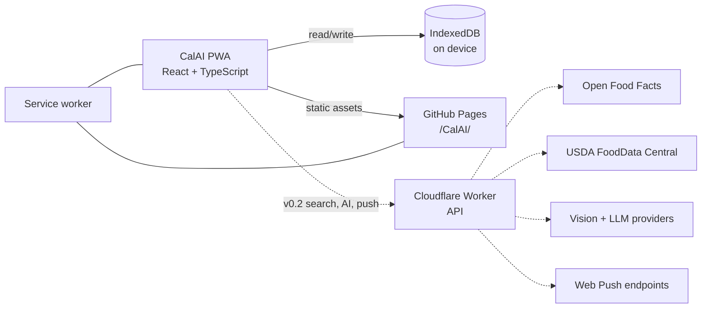

# CalAI — architecture and implementation plan

This document covers how the product plan in [../PLAN.md](../PLAN.md) gets built. It
describes the v0.1 implementation that exists in this repository and the extensions planned
for v0.2/v0.3. Nothing in the "planned" sections is implemented yet.

## 1. System overview



v0.1 is the left side only: a static PWA that stores everything on the device. No server,
no accounts, no network calls at runtime except the app's own assets.

## 2. Stack

Chosen and shipped in v0.1:

- **Vite** (v6 line, compatible with the installed Node 20.12) + **React 18** + **TypeScript**.
- **HashRouter** (`#/today`, `#/foods`, …) so deep links work on GitHub Pages without a
  rewrite hack, including offline.
- **Zustand** for app state, with the persist middleware backed by **idb-keyval** (IndexedDB).
- **HashRouter** routes: `#/today`, `#/day/YYYY-MM-DD`, `#/foods`, `#/history`, `#/settings`.
- **Plain CSS** with design tokens; no UI kit. Avoids restyling fights and keeps the payload small.
- **vite-plugin-pwa** (Workbox) for the manifest, icons, and precached app shell.
- **Vitest** for nutrition, date, and import/export tests.
- Inline SVG icon components; no icon library.
- System font stack; no third-party font requests (privacy, offline, speed).

Planned additions, by release:

| Need | Choice | Release |
| --- | --- | --- |
| Remote food search | Cloudflare Worker + KV cache; OFF and USDA | v0.2 |
| Barcode | `BarcodeDetector` with `@zxing/browser` fallback | v0.2 |
| Push reminders | Worker cron + `web-push` + VAPID + KV | v0.2 |
| Vision / text parsing | Worker → multimodal model, JSON schema | v0.3 |
| Chat | Worker + locally computed context; optional client tools | v0.3 |
| E2E tests | Playwright (Chromium/Edge, mobile viewports) | v0.2 |
| Charts | Hand-rolled SVG (no chart library) | v0.2 |

## 3. Repository layout

Current:

```
.
├── index.html              # Vite entry; React mounts into #root
├── 404.html
├── assets/                 # built output is not committed
├── public/                 # icons, manifest inputs
├── src/
│   ├── main.tsx
│   ├── app/                # shell, routes, providers
│   ├── components/         # shared UI (Sheet, Button, Progress, …)
│   ├── features/
│   │   ├── onboarding/
│   │   ├── today/
│   │   ├── foods/
│   │   ├── history/
│   │   └── settings/
│   ├── lib/                # db, dates, nutrition, format, import/export
│   ├── data/seedFoods.ts
│   ├── store/
│   └── styles/
├── docs/
├── vite.config.ts
├── tsconfig.json
└── package.json
```

Planned at v0.2+:

```
worker/
  src/index.ts             # router: search, barcode, ai, push, session
  src/providers/           # off, usda, vision, llm
  src/push/                # subscribe, cron, cleanup
  wrangler.toml
```

The Worker is a separate deployable with its own secrets. The PWA remains static.

## 4. Data model

All timestamps are epoch milliseconds. Day keys are local `YYYY-MM-DD` strings, never UTC
dates.

```ts
type Meal = 'breakfast' | 'lunch' | 'dinner' | 'snack';

type Nutrients = { kcal: number; protein: number; carbs: number; fat: number };

type Food = {
  id: string;
  name: string;
  brand?: string;
  barcode?: string;
  servingLabel: string;      // "1 large", "100 g", "1 cup"
  servingGrams?: number;
  nutrients: Nutrients;      // per serving
  source: 'seed' | 'custom' | 'off' | 'usda';
  createdAt: number;
  updatedAt: number;
};

type Entry = {
  id: string;
  date: string;              // local YYYY-MM-DD
  meal: Meal;
  foodId?: string;           // absent for quick add
  name: string;
  servingLabel: string;
  quantity: number;          // multiplier of the serving
  nutrients: Nutrients;      // per-serving snapshot, frozen at log time
  createdAt: number;
};

type Targets = { kcal: number; protein: number; carbs: number; fat: number };

type Profile = {
  sex: 'female' | 'male' | 'unspecified';
  age: number;
  heightCm: number;
  weightKg: number;
  activity: 'sedentary' | 'light' | 'moderate' | 'active' | 'very_active';
  goal: 'lose' | 'maintain' | 'gain';
  rateKgPerWeek: number;
};

type PersistedV1 = {
  schemaVersion: 1;
  onboarded: boolean;
  profile: Profile | null;
  targets: Targets;
  customFoods: Food[];
  entries: Entry[];
  favorites: string[];
  recentFoodIds: string[];
  settings: { theme: 'dark' | 'light' | 'system'; units: 'metric' | 'imperial' };
};
```

Planned v0.2+ records: `weights`, `water`, `recipes`, `reminders`, `pushSubscriptions`
(server-side only), `chats`, `messages`, `aiJobs`. They will move to granular IndexedDB
stores with indexes (`entries.byDate`, `foods.byLastUsed`, `foods.byBarcode`) and versioned
migrations.

### v0.1 persistence

- One IndexedDB key (`calai:v1`) via `idb-keyval`, written by Zustand's persist middleware.
- Hydration is gated: the app renders a quiet splash until storage resolves, then either
  onboarding or the diary. This prevents an onboarding flash.
- Writes go through Zustand persist to a single IndexedDB key; the payload is small (text only).
- Storage is requested persistent on first successful log (`navigator.storage.persist()`)
  where supported.
- Export envelope: `{ app: "calai", schemaVersion: 1, exportedAt, data }`. Import validates
  the envelope and every nutrient number; unknown keys are dropped.

### Nutrition and target math

- Stored food nutrients are per serving. Entries keep a per-serving snapshot and a quantity
  multiplier; totals multiply on read, so editing a food never rewrites old days.
- Totals are pure functions over entries for a date, rounded for display only.
- Targets: Mifflin–St Jeor BMR × activity factor, adjusted by goal and rate
  (≈ 7700 kcal per kg). Protein default 1.6 g/kg, fat 25% of kcal, carbs fill the rest.
- A 1200 kcal floor is enforced with a non-judgemental note; manual targets may still be
  lower only with a warning. This is a safety guardrail, not medical advice.
- Units: metric internally (kg, cm); imperial is presentation-only in v0.1.

## 5. Food data

v0.1 ships a curated seed list (≈ 100 common foods) in the bundle. Seed foods are not
editable; users create custom foods. Search covers seed + custom + recents and is
case-insensitive over name/brand. Recents are derived from `recentFoodIds` updated on log.

v0.2 remote search:

- **Open Food Facts** — barcode and product search, ODbL, attribution required.
- **USDA FoodData Central** — public domain, API key required; US-centric but high quality.
- Worker merges and normalises results to the `Food` shape, dedupes by barcode/name, and
  caches responses in KV (7 days). Client caches looked-up foods in IndexedDB.
- Results always show the source; unverified community data is labelled.
- Seed foods remain available offline; remote results require network and fail gracefully.

## 6. AI architecture (v0.3, planned)

### Endpoints

| Endpoint | Purpose | Rate limit |
| --- | --- | --- |
| `POST /v1/session` | Issue signed random device token | 3/day per IP |
| `POST /v1/vision/analyze` | Image → structured food candidates | 5/day per device |
| `POST /v1/text/parse` | Text → structured items | 20/day per device |
| `POST /v1/chat` | Grounded Q&A | 30/day per device |
| `POST /v1/foods/search` | OFF/USDA proxy | 120/day per device |

Quotas live in KV with a daily reset; a global monthly budget cap short-circuits the Worker.
No API keys ever reach the client.

### Vision flow

1. Client downscales to ≤ 1024 px JPEG (canvas), strips EXIF, shows consent.
2. `POST /v1/vision/analyze` with multipart image + device token.
3. Worker validates magic bytes and size, calls the provider with a JSON schema:
   `{ items: [{ name, quantity, unit, grams, confidence }], note }`.
4. Worker returns candidates only; it does not store the image.
5. Client resolves each name against local foods, then remote search; unresolved items offer
   custom-food prefill.
6. User edits portions and confirms. Entry snapshots are created locally.
7. Failure/offline/over-quota → a clear message and the normal search flow.

### Text and voice

Text parsing reuses the schema minus the image. Voice input uses `SpeechRecognition` where
available and simply fills the text field; no raw audio is uploaded.

### Chat

- Context is assembled on the client: goal, 7/14/30-day totals, averages, macro split,
  logging days, and recent food names. No email, account ID, or raw entry list.
- v0.3 answers one-shot over that context. If tools are added, they execute client-side or
  return aggregates; server-side storage of health data remains out of scope.
- Response contract: plain text with a required `window` label rendered as a chip. Numeric
  claims must come from the supplied context. Missing data is stated explicitly.
- Local transcript; clear-chat; per-message feedback stored locally only.
- Prompts and evals are versioned in the repo. A 30-question eval with known data must reach
  ≥ 90% numeric accuracy and zero unsafe medical advice before release.

### Safety and privacy

- Opt-in consent before the first AI request; the diary is otherwise never uploaded.
- Provider APIs configured for no training / zero retention where offered.
- Image and text payloads are not logged by the Worker; errors log status codes only.
- System prompt forbids medical diagnosis, extreme dieting, and shaming; a 1200 kcal floor
  and "hide numbers" mode are UX guardrails.
- AI output is labelled as an estimate.

## 7. Reminders (v0.2, planned)

Local tier:

- In-app banner and `Notification` while the app is open.
- `.ics` export for meal reminders (works everywhere, no permissions).
- Copy makes the limitation explicit; no fake "scheduled" state.

Push tier:

- Worker issues VAPID keys; client subscribes via the service worker.
- KV stores `{ deviceId, endpoint, keys, timezone, reminders[], enabled, updatedAt }`. No
  account and no health data.
- Cron runs every 5 minutes, resolves local times with `Intl.DateTimeFormat`, and sends
  generic payloads ("Time to log dinner") with a deep link to the meal.
- Dead subscriptions (404/410) are deleted. Unsubscribe deletes the record.
- Quiet hours and per-reminder toggles. iOS requires an installed PWA and explicit permission;
  the UI detects and explains this.

## 8. PWA and offline

- `vite-plugin-pwa` precaches the app shell, hashed assets, icons, and seed data.
- Navigation uses hash routes, so no server-side fallback is needed.
- Cache strategies: precache for app assets; stale-while-revalidate for Google-free static
  assets; network-only for AI and remote search; cache-first for food lookups in IndexedDB.
- Update flow: `autoUpdate` in alpha; a "new version" prompt lands with v0.2 to avoid
  interrupting an open entry sheet.
- Manifest: `start_url` and `scope` under `/CalAI/`, standalone display, dark theme,
  192/512 PNG + maskable, Apple touch icon, safe-area CSS.
- Storage: ask for persistence after the first log; surface export as the reliable backup.

## 9. Deployment

v0.1+ PWA:

- GitHub Actions workflow builds with Node 20 and publishes `dist` via
  `actions/configure-pages`, `actions/upload-pages-artifact`, `actions/deploy-pages`.
- Pages source is **GitHub Actions** (`build_type: workflow`); `.github/workflows/deploy.yml`
  runs tests, builds, and deploys `dist/` on every push to `main`.
- `vite.config.ts` sets `base: '/CalAI/'`; the manifest mirrors it.
- No secrets are needed for v0.1.

Worker (v0.2+):

- Separate `wrangler deploy`; secrets via `wrangler secret put` (AI keys, VAPID private key,
  USDA key).
- CORS allowlist: `https://braillegov.github.io`.
- Cron trigger every 5 minutes; KV namespace for quotas, cache, subscriptions.
- Local dev: `wrangler dev`, client points to `http://localhost:8787` via env.

Headers: GitHub Pages cannot set response headers. A `<meta http-equiv="Content-Security-Policy">`
is added at v1.0 after auditing inline styles; `frame-ancestors` is not enforceable that way.
The Worker sets its own CSP/CORS headers.

## 10. Security, privacy, legal

- Health data is sensitive. Local-first by default; no analytics on food names or values.
- No third-party scripts in v0.1. If analytics are added, they are cookieless, consent-gated,
  and limited to interaction events.
- AI requests carry a random device token, not identity. Tokens expire; quotas are per device
  and per IP.
- Worker: payload size caps, image magic-byte checks, rate limits, output schema validation,
  no content logging, explicit timeouts, and provider fallback.
- Export/delete-all must always be available.
- Before public launch: privacy policy, terms, AI disclaimer, data-source attributions
  (Open Food Facts ODbL, USDA), and a contact address.
- Accessibility target: WCAG 2.2 AA — labels, focus traps in dialogs, 44 px targets, no
  colour-only status, reduced motion.

## 11. Testing and QA

- **Unit (Vitest):** target math, macro rounding, date keys across DST, search ranking,
  import validation, nutrient scaling.
- **Component:** entry sheet, quantity stepper, onboarding validation.
- **E2E (Playwright, v0.2):** onboarding → log → reload persistence → edit → export, at
  390 × 844; offline reload; dialog keyboard behaviour; axe scan.
- **Device pass:** iPhone Safari (installed), Android Chrome, desktop Chromium.
- **Performance:** Lighthouse budgets; initial JS < 200 KB gzip.
- **AI evals (v0.3):** 50 labelled photos, 30 scripted chat questions, unsafe-output review,
  cost per accepted log measured before launch.

## 12. Observability and cost

- v0.1: none beyond build/deploy status and local error surfaces.
- v0.2+: Cloudflare Worker logs for status/latency only; error reporting (e.g. Sentry) is
  opt-in and scrubbed of health content.
- Recurring cost target: $0 for Pages/KV at alpha scale; AI capped by a monthly budget
  (decision pending) with a hard stop and graceful fallback.

## 13. Versioning and migration

- Persisted state includes `schemaVersion`. v0.1 writes version 1.
- On load, unknown future versions show a blocking "update the app" message rather than
  corrupting data.
- Migrations are pure functions tested against fixtures. Granular IndexedDB stores arrive in
  v0.2 with a one-time migration from `calai:v1`.
- Export is versioned and remains importable by later versions; import validates ranges
  (non-negative nutrients, sane quantities, ISO dates).

## 14. Build order

1. Scaffold Vite/React/TS, tokens, shell, routing, PWA manifest.
2. Store + IndexedDB hydration + seed foods + target math (unit tests).
3. Onboarding and target review.
4. Diary: day navigation, meals, entries, quick add, portion sheet.
5. Food library: search, custom foods, recents, favorites.
6. History and settings (export/import/reset).
7. QA: 360/390 px, keyboard, offline, reload persistence, auth-free install.
8. Actions workflow, switch Pages source, verify live URL and custom 404.

v0.1 shipped on 2026-10-24 and the acceptance list in [../PLAN.md](../PLAN.md#3-releases)
passes on the live site.


## 15. v0.1 verification record

- Unit tests: 24 passing across nutrition/target math, date keys, food search, and backup
  validation.
- Browser smoke (Edge, 390 × 844, mobile emulation): onboarding in metric and imperial,
  logging from search, quick add, custom foods, entry edit/delete, export/import, reset,
  validation errors, theme persistence across reloads, scroll reset on navigation, Escape
  closing sheets, and a full offline reload served by the service worker.
- Layout: no horizontal overflow at 360 px or 390 px; frame caps at 560 px on desktop.
- PWA: manifest resolves at `/CalAI/manifest.webmanifest` with `/CalAI/` scope and three
  icons; service worker registers and controls the page on the live HTTPS origin.
- axe-core: 0 WCAG 2.1 A/AA violations across onboarding, diary, add/edit sheets, foods,
  history, and settings in dark and light themes.
- Lighthouse mobile (production build): Performance 99, Accessibility 100, Best Practices
  100, SEO 60 (intentional `noindex` during alpha).
- Bundle: initial JS 72.9 KB gzip, CSS 5.8 KB gzip.
- Live: <https://braillegov.github.io/CalAI/>, custom 404 served, HTTP redirects to HTTPS.
