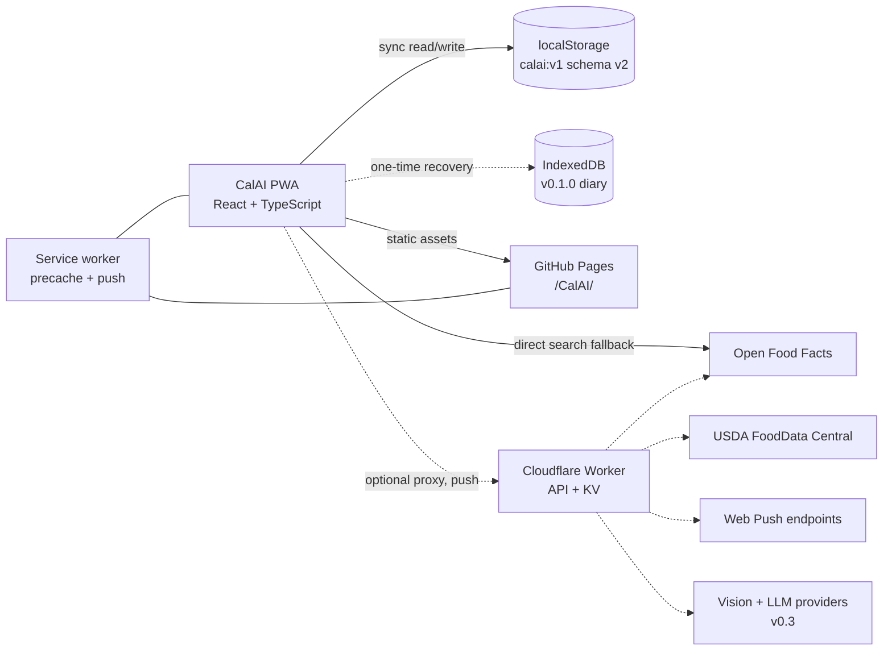

# CalAI — architecture and implementation plan

This document covers how the product plan in [../PLAN.md](../PLAN.md) gets built. It
describes the v0.2 implementation in this repository and the extensions planned for v0.3.
Operational caveats and a handoff prompt are in [../NOTES.md](../NOTES.md).

## 1. System overview



The diary is always local. Online food search is the only runtime read in v0.2; it uses a
configured Worker when present, otherwise Open Food Facts directly. Web Push is opt-in and
inactive without Worker/VAPID configuration. There are still no accounts and no analytics.

## 2. Stack

Chosen and shipped through v0.2:

- **Vite** (v6 line, compatible with the installed Node 20.12) + **React 18** + **TypeScript**.
- **HashRouter** (`#/today`, `#/foods`, …) so deep links work on GitHub Pages without a
  rewrite hack, including offline.
- **Zustand** for app state, with the persist middleware backed by a synchronous
  **localStorage** adapter (`calai:v1`). **idb-keyval** is used only for a bounded one-time
  read of the v0.1.0 IndexedDB diary.
- **HashRouter** routes: `#/today`, `#/day/YYYY-MM-DD`, `#/foods`, `#/recipes`,
  `#/history`, `#/settings`.
- **Plain CSS** with design tokens; no UI kit. Avoids restyling fights and keeps the payload small.
- **vite-plugin-pwa** with `injectManifest`; a hand-written `src/sw.ts` precaches the app
  shell, serves navigation offline, and handles push/notification clicks.
- **Vitest** for nutrition, dates, backup/migration, recipes, reminders, remote parsing, and
  Worker normalization.
- **Playwright + axe-core** for committed E2E regressions and accessibility scans.
- **Cloudflare Worker** (`worker/`) for optional search caching, USDA, rate caps, and push.
- Inline SVG icon components; no icon library.
- System font stack; no third-party font requests (privacy, offline, speed).

Additional choices, by release:

| Need | Choice | Release |
| --- | --- | --- |
| Remote food search | OFF direct fallback; Worker + KV cache + USDA | **v0.2** |
| Barcode | `BarcodeDetector` with lazy `@zxing/browser` fallback | **v0.2** |
| Push reminders | Worker cron + `web-push` + VAPID + KV | **v0.2 code; config pending** |
| Vision / text parsing | Worker → multimodal model, JSON schema | v0.3 |
| Chat | Worker + locally computed context; optional client tools | v0.3 |
| E2E tests | Playwright (Chromium, mobile viewport) | **v0.2** |
| Charts | Hand-rolled SVG (no chart library) | **v0.2** |

## 3. Repository layout

Current:

```
.
├── index.html              # Vite entry; React mounts into #root
├── 404.html
├── assets/                 # built output is not committed
├── public/                 # icons, manifest inputs
├── src/
│   ├── main.tsx
│   ├── app/                # shell, routes, providers
│   ├── components/         # shared UI (Sheet, Button, Progress, …)
│   ├── features/
│   │   ├── onboarding/
│   │   ├── today/
│   │   ├── foods/
│   │   ├── recipes/
│   │   ├── history/
│   │   └── settings/
│   ├── lib/                # dates, nutrition, search, backup, remote, recipes, push
│   ├── data/seedFoods.ts
│   ├── store/
│   ├── styles/
│   └── sw.ts               # injectManifest service worker + push handlers
├── worker/                 # optional Cloudflare Worker
├── e2e/                    # committed Playwright suite
├── docs/
├── vite.config.ts
├── tsconfig.json
└── package.json
```

Worker (shipped in v0.2):

```
worker/
  src/index.ts             # router: search, barcode, push, scheduled cron
  src/normalize.ts         # OFF/USDA → FoodDTO, dedupe, relevance, ranking
  src/providers/off.ts
  src/providers/usda.ts
  src/cache.ts             # KV cache + per-IP daily cap
  src/types.ts
  wrangler.toml
```

The Worker is a separate deployable with its own secrets. The PWA remains static and fully
usable without it.

## 4. Data model

All timestamps are epoch milliseconds. Day keys are local `YYYY-MM-DD` strings, never UTC
dates.

```ts
type Meal = 'breakfast' | 'lunch' | 'dinner' | 'snack';

type Nutrients = { kcal: number; protein: number; carbs: number; fat: number };

type Food = {
  id: string;
  name: string;
  brand?: string;
  barcode?: string;
  servingLabel: string;      // "1 large", "100 g", "1 cup"
  servingGrams?: number;
  nutrients: Nutrients;      // per serving
  source: 'seed' | 'custom' | 'off' | 'usda' | 'recipe';
  createdAt: number;
};

type Entry = {
  id: string;
  date: string;              // local YYYY-MM-DD
  meal: Meal;
  foodId?: string;           // absent for quick add
  name: string;
  servingLabel: string;
  quantity: number;          // multiplier of the serving
  nutrients: Nutrients;      // per-serving snapshot, frozen at log time
  createdAt: number;
};

type Targets = { kcal: number; protein: number; carbs: number; fat: number };

type Profile = {
  sex: 'female' | 'male' | 'unspecified';
  age: number;
  heightCm: number;
  weightKg: number;
  activity: 'sedentary' | 'light' | 'moderate' | 'active' | 'very_active';
  goal: 'lose' | 'maintain' | 'gain';
  rateKgPerWeek: number;
};

type RecipeIngredient = {
  foodId?: string;
  name: string;
  servingLabel: string;
  quantity: number;
  nutrients: Nutrients;      // per serving of the ingredient
};

type Recipe = {
  id: string;
  name: string;
  servings: number;
  ingredients: RecipeIngredient[];
  createdAt: number;
  updatedAt: number;
};

type WeightEntry = { id: string; date: string; kg: number; createdAt: number };
type WaterEntry = { id: string; date: string; ml: number; createdAt: number };

type Reminder = { id: string; meal: Meal; time: string; enabled: boolean };
type ReminderSettings = {
  enabled: boolean;
  quietStart: string;        // HH:MM
  quietEnd: string;
  items: Reminder[];
};

type PersistedV2 = {
  schemaVersion: 2;
  onboarded: boolean;
  profile: Profile | null;
  targets: Targets;
  customFoods: Food[];
  remoteFoods: Food[];       // capped at 100 cached OFF/USDA foods
  entries: Entry[];
  favorites: string[];
  recentFoodIds: string[];
  recipes: Recipe[];
  weights: WeightEntry[];
  water: WaterEntry[];
  reminders: ReminderSettings;
  settings: {
    theme: 'dark' | 'light' | 'system';
    units: 'metric' | 'imperial';
    waterGoalMl: number;
  };
};
```

The Worker stores only push subscriptions (`endpoint`, keys, timezone, reminder times,
quiet hours, random device ID) in KV. It never stores diary entries or food logs. v0.3 AI
records (`chats`, `messages`, `aiJobs`) remain local unless an explicit request is made.

### Persistence and migration (v0.1.1 → v0.2)

v0.1.0 shipped with asynchronous IndexedDB hydration. When IndexedDB was blocked (privacy
settings, private windows, in-app browsers) or an open request never settled, the app stayed
on its opening screen forever. v0.1.1 removes that failure mode:

- The diary is a synchronous localStorage document at `calai:v1`, written by Zustand persist.
  There is no storage-driven splash and no async gate before onboarding.
- `calai-theme` mirrors the theme setting for the pre-hydration inline script.
- `calai:legacy-checked` records that the one-time IndexedDB migration was attempted.
- On first run, a **bounded background read** (1.2 s timeout) of the old `calai:v1` IndexedDB
  key via `idb-keyval` imports a v0.1.0 diary only if the current state is empty. The UI is
  already interactive while this happens; a toast confirms a restore. A missing, blocked, or
  corrupt legacy store is ignored and marked checked.
- localStorage writes are wrapped in try/catch. If storage is blocked entirely, the app runs
  in memory and shows a persistent warning; nothing silently hangs.
- Corrupt persisted JSON is discarded so the app falls back to onboarding instead of crashing.
- Storage is requested persistent on first log (`navigator.storage.persist()`) where supported.
- Payload size is small (entries, custom foods, saved online foods, recipes, weights, water,
  settings; seed foods are static). The remote-food cache is capped at 100 items. v0.2 keeps
  localStorage; granular IndexedDB is deferred until measured payload/write growth justifies
  it.
- v0.2 uses `schemaVersion: 2`. `validatePersistedData` accepts v1 or v2; v1 documents and
  backups are normalised in memory (new arrays + `waterGoalMl: 2000`) and written back as v2.
  Unknown future versions are rejected. The Zustand storage adapter always returns version 2
  after validation, so no async migration gate is introduced.
- Export envelope: `{ app: "calai", schemaVersion: 2, exportedAt, data }`. Import validates
  the envelope and every nutrient number; importing a v1 backup migrates it first.

### Nutrition and target math

- Stored food nutrients are per serving. Entries keep a per-serving snapshot and a quantity
  multiplier; totals multiply on read, so editing a food never rewrites old days.
- Totals are pure functions over entries for a date, rounded for display only.
- Targets: Mifflin–St Jeor BMR × activity factor, adjusted by goal and rate
  (≈ 7700 kcal per kg). Protein default 1.6 g/kg, fat 25% of kcal, carbs fill the rest.
- A 1200 kcal floor is enforced with a non-judgemental note; manual targets may still be
  lower only with a warning. This is a safety guardrail, not medical advice.
- Units: metric internally (kg, cm, ml); imperial is presentation-only for body stats,
  weight, water, and portions.

## 5. Food data

v0.1 ships a curated seed list (≈ 100 common foods) in the bundle. Seed foods are not
editable; users create custom foods. Search covers seed + custom + recents and is
case-insensitive over name/brand. Recents are derived from `recentFoodIds` updated on log.

v0.2 remote search:

- **Open Food Facts** — product search and barcode lookup, ODbL, attribution required. The
  client can query it directly (CORS) when `VITE_API_BASE` is unset.
- **USDA FoodData Central** — public domain, API key required; US-centric but higher quality.
  Only available through the Worker; the key never reaches the client.
- The Worker normalises both providers to a 100 g `Food` shape, dedupes by barcode/name,
  filters out products whose name/brand does not contain every query token, ranks exact and
  prefix matches first, and caches successful responses in KV for 7 days.
- The client applies the same relevance filter to direct OFF results. Results always show the
  source; community data is labelled as an estimate.
- Seed foods remain available offline. Remote results require network and fail gracefully;
  a food is written to the local `remoteFoods` cache when selected/logged, so it can be
  searched and logged offline afterwards.
- A Worker request is capped per IP per UTC day (default 300) when KV is bound. Search and
  barcode responses include `sources` and `cached` metadata.

## 6. AI architecture (v0.3, planned)

### Endpoints

| Endpoint | Purpose | Rate limit |
| --- | --- | --- |
| `POST /v1/session` | Issue signed random device token | 3/day per IP |
| `POST /v1/vision/analyze` | Image → structured food candidates | 5/day per device |
| `POST /v1/text/parse` | Text → structured items | 20/day per device |
| `POST /v1/chat` | Grounded Q&A | 30/day per device |
| `GET /v1/foods/search` | OFF/USDA proxy | 300/day per IP (KV, v0.2) |

Quotas live in KV with a daily reset; a global monthly budget cap short-circuits the Worker.
No API keys ever reach the client.

### Vision flow

1. Client downscales to ≤ 1024 px JPEG (canvas), strips EXIF, shows consent.
2. `POST /v1/vision/analyze` with multipart image + device token.
3. Worker validates magic bytes and size, calls the provider with a JSON schema:
   `{ items: [{ name, quantity, unit, grams, confidence }], note }`.
4. Worker returns candidates only; it does not store the image.
5. Client resolves each name against local foods, then remote search; unresolved items offer
   custom-food prefill.
6. User edits portions and confirms. Entry snapshots are created locally.
7. Failure/offline/over-quota → a clear message and the normal search flow.

### Text and voice

Text parsing reuses the schema minus the image. Voice input uses `SpeechRecognition` where
available and simply fills the text field; no raw audio is uploaded.

### Chat

- Context is assembled on the client: goal, 7/14/30-day totals, averages, macro split,
  logging days, and recent food names. No email, account ID, or raw entry list.
- v0.3 answers one-shot over that context. If tools are added, they execute client-side or
  return aggregates; server-side storage of health data remains out of scope.
- Response contract: plain text with a required `window` label rendered as a chip. Numeric
  claims must come from the supplied context. Missing data is stated explicitly.
- Local transcript; clear-chat; per-message feedback stored locally only.
- Prompts and evals are versioned in the repo. A 30-question eval with known data must reach
  ≥ 90% numeric accuracy and zero unsafe medical advice before release.

### Safety and privacy

- Opt-in consent before the first AI request; the diary is otherwise never uploaded.
- Provider APIs configured for no training / zero retention where offered.
- Image and text payloads are not logged by the Worker; errors log status codes only.
- System prompt forbids medical diagnosis, extreme dieting, and shaming; a 1200 kcal floor
  and "hide numbers" mode are UX guardrails.
- AI output is labelled as an estimate.

## 7. Reminders (v0.2)

Local tier (shipped):

- Four meal reminder times, off by default; global enable plus per-meal toggles.
- In-app banner on Today during the 90 minutes after an enabled time. Quiet hours suppress
  the banner and push. Dismissal is stored per day/meal in localStorage.
- `.ics` export with one daily recurring VEVENT per enabled reminder and a 5-minute VALARM.
  Works in any calendar with no permissions; the UI states that CalAI itself cannot wake a
  closed browser without push.

Push tier (implemented, inactive until configured):

- VAPID keys live as Worker secrets; the client subscribes through the service worker only
  after an explicit button press and a Notification permission grant.
- KV stores `{ endpoint, keys, timezone, reminders[], quietStart, quietEnd, deviceId,
  updatedAt }`. The device ID is random and unlinked to an account; no health data.
- The Worker cron runs every 5 minutes, resolves local times with `Intl.DateTimeFormat`,
  sends generic payloads ("Time to log dinner") with a deep link to Today, and records a
  per-day sent marker to avoid duplicate delivery.
- Dead subscriptions (404/410) are deleted. Unsubscribe deletes the record and the device
  index. Payloads contain no food names or calorie values.
- iOS requires an installed PWA and explicit permission; the UI explains when push is not
  configured. Local reminders and `.ics` are the guaranteed fallback.

## 8. PWA and offline

- `vite-plugin-pwa` runs in `injectManifest` mode; `src/sw.ts` calls `precacheAndRoute` for
  the app shell, hashed assets, icons, and the lazy ZXing chunk, with a NavigationRoute
  fallback to `/CalAI/index.html`.
- Navigation uses hash routes, so no server-side rewrite is needed. Remote search is
  network-only and is never precached; selected remote foods are persisted in localStorage.
- Update flow: `autoUpdate` with `skipWaiting` in alpha. There is still no non-blocking "new
  version" prompt before an entry sheet; this remains a v0.2.x improvement.
- The service worker handles `push` and `notificationclick`: generic payload, icon, meal tag,
  and focus/open the Today route. Camera frames and barcode values never enter the cache.
- Manifest: `start_url` and `scope` under `/CalAI/`, standalone display, dark theme,
  192/512 PNG + maskable, Apple touch icon, safe-area CSS.
- Storage: ask for persistence after the first log; surface export as the reliable backup.

## 9. Deployment

v0.2 PWA:

- GitHub Actions workflow builds with Node 20 and publishes `dist` via
  `actions/configure-pages`, `actions/upload-pages-artifact`, `actions/deploy-pages`.
- Pages source is **GitHub Actions** (`build_type: workflow`); `.github/workflows/deploy.yml`
  runs unit tests, typecheck, build, installs Playwright Chromium, runs the committed E2E
  suite, and only then deploys `dist/` on every push to `main`.
- `vite.config.ts` sets `base: '/CalAI/'`; the manifest mirrors it.
- No secrets are needed for the static app. Search/push env values are build-time `VITE_*`
  variables only when the optional Worker is enabled.

Worker (v0.2):

- Separate `cd worker && npm install && npx wrangler deploy`; create the `CALAI_CACHE` KV
  namespace and paste its id into `worker/wrangler.toml`.
- Secrets via `wrangler secret put`: `USDA_API_KEY` (optional), `VAPID_PUBLIC_KEY`,
  `VAPID_PRIVATE_KEY`, `VAPID_SUBJECT`. The VAPID public key is also passed to the client as
  `VITE_VAPID_PUBLIC_KEY` at build time.
- `compatibility_flags = ["nodejs_compat"]` for `web-push`.
- CORS allowlist defaults to `https://braillegov.github.io`, localhost dev ports, and
  `127.0.0.1`; override with `ALLOWED_ORIGINS`.
- Cron trigger every 5 minutes; KV stores search cache, barcode cache, per-IP daily counters,
  push subscriptions, device indexes, and sent markers.
- Local dev: `wrangler dev`, then build the client with `VITE_API_BASE=http://localhost:8787`.
  `worker/README.md` has the full setup and smoke-test notes.
- The Worker was not deployed in the v0.2 session (no active Cloudflare credentials). The
  static app therefore uses direct Open Food Facts. This is a deployment gap, not a missing
  code path.

Headers: GitHub Pages cannot set response headers. A `<meta http-equiv="Content-Security-Policy">`
is added at v1.0 after auditing inline styles; `frame-ancestors` is not enforceable that way.
The Worker sets its own CSP/CORS headers.

## 10. Security, privacy, legal

- Health data is sensitive. Local-first by default; no analytics on food names or values.
- No third-party scripts in v0.1. If analytics are added, they are cookieless, consent-gated,
  and limited to interaction events.
- AI requests carry a random device token, not identity. Tokens expire; quotas are per device
  and per IP.
- Worker: payload size caps, image magic-byte checks, rate limits, output schema validation,
  no content logging, explicit timeouts, and provider fallback.
- Export/delete-all must always be available.
- Before public launch: privacy policy, terms, AI disclaimer, data-source attributions
  (Open Food Facts ODbL, USDA), and a contact address.
- Accessibility target: WCAG 2.2 AA — labels, focus traps in dialogs, 44 px targets, no
  colour-only status, reduced motion.

## 11. Testing and QA

- **Unit (Vitest):** target math, macro rounding, date keys across DST, search ranking,
  import validation and v1→v2 migration, nutrient scaling, recipe totals, reminder windows
  and `.ics`, OFF parsing, and Worker normalization/relevance.
- **E2E (Playwright, committed and in CI):** onboarding → log → reload persistence → edit →
  delete → export/import at 390 × 844; blocked localStorage, blocked IndexedDB, corrupt
  state, legacy IDB recovery; offline reload; online search success/failure; manual barcode
  lookup; recipe creation/logging; water and weight persistence; reminder banner and `.ics`
  download; horizontal overflow at 360/390 px; axe scans in both themes.
- **Accessibility:** axe-core with WCAG 2.0/2.1/2.2 A/AA tags, animations finished before
  scanning, 0 violations on all main screens and open sheets.
- **Device pass:** iPhone Safari (installed), Android Chrome, desktop Chromium.
- **Performance:** Lighthouse budgets; initial JS < 200 KB gzip.
- **AI evals (v0.3):** 50 labelled photos, 30 scripted chat questions, unsafe-output review,
  cost per accepted log measured before launch.

## 12. Observability and cost

- v0.1: none beyond build/deploy status and local error surfaces.
- v0.2+: Cloudflare Worker logs for status/latency only; error reporting (e.g. Sentry) is
  opt-in and scrubbed of health content.
- Recurring cost target: $0 for Pages/KV at alpha scale; AI capped by a monthly budget
  (decision pending) with a hard stop and graceful fallback.

## 13. Versioning and migration

- Persisted state includes `schemaVersion`. v0.1 writes version 1; v0.2 writes version 2.
- `validatePersistedData` migrates v1 to v2 in memory and rejects unknown future versions.
  The storage adapter always returns version 2 after validation, so no async migration gate
  is introduced.
- Migrations are pure functions tested against fixtures, including a legacy IndexedDB v0.1
  diary and a v1 JSON backup.
- Export is versioned and later versions can still import it; import validates ranges
  (non-negative nutrients, sane quantities, ISO dates, reminder times, barcode limits).
- Granular IndexedDB stores are deferred to v0.3 and require a measured reason plus a
  migration; localStorage remains synchronous in v0.2.

## 14. Build order

1. Scaffold Vite/React/TS, tokens, shell, routing, PWA manifest.
2. Store + synchronous persistence + seed foods + target math (unit tests).
3. Onboarding and target review.
4. Diary: day navigation, meals, entries, quick add, portion sheet.
5. Food library: search, custom foods, recents, favorites.
6. History and settings (export/import/reset).
7. QA: 360/390 px, keyboard, offline, reload persistence, auth-free install.
8. Actions workflow, switch Pages source, verify live URL and custom 404.
9. v0.2: committed Playwright/axe suite, schema v2 migration, online search, barcode,
   recipes, weight, water, reminders.
10. v0.2.x: deploy Worker + KV, add USDA key, configure VAPID, device pass.

v0.1.0 shipped on 2026-10-24; v0.1.1 hardened storage; v0.2.0 shipped on 2026-10-24 with
the features above. The acceptance lists in [../PLAN.md](../PLAN.md#3-releases) pass locally;
the Worker and push tiers still need deployment credentials.

## 15. v0.1 verification record

- Unit tests: 27 passing across nutrition/target math, date keys, food search, backup
  validation, and legacy IndexedDB state parsing.
- Browser smoke (Edge, 390 × 844, mobile emulation): onboarding in metric and imperial,
  logging from search, quick add, custom foods, entry edit/delete, export/import, reset,
  validation errors, theme persistence across reloads, scroll reset on navigation, Escape
  closing sheets, and a full offline reload served by the service worker.
- Layout: no horizontal overflow at 360 px or 390 px; frame caps at 560 px on desktop.
- Storage recovery: blocked IndexedDB no longer blocks onboarding; a seeded v0.1.0
  IndexedDB diary migrates to localStorage; blocked localStorage shows a warning and the app
  remains usable in memory; corrupt persisted JSON recovers to onboarding.
- PWA: manifest resolves at `/CalAI/manifest.webmanifest` with `/CalAI/` scope and three
  icons; service worker registers and controls the page on the live HTTPS origin.
- axe-core: 0 WCAG 2.1 A/AA violations across onboarding, diary, add/edit sheets, foods,
  history, and settings in dark and light themes.
- Lighthouse mobile (live deployment): Performance 100, Accessibility 100, Best Practices
  100, SEO 60 (intentional `noindex` during alpha).
- Bundle: initial JS 73.3 KB gzip, CSS 5.8 KB gzip.
- Live: <https://braillegov.github.io/CalAI/>, custom 404 served, HTTP redirects to HTTPS.
- Version: v0.1.1.

## 16. v0.2 verification record

- Unit tests: 46 passing (nutrition/target math, dates, search, backup validation and v1→v2
  migration, legacy IndexedDB recovery, recipes, reminders incl. `.ics`, remote OFF parsing,
  Worker normalization/relevance).
- Playwright: 30 tests passing on Chromium at 390 × 844 (Pixel 7 descriptor), including
  onboarding, logging, edit/delete, quick add, custom foods, favorites, export/import,
  malformed imports, blocked localStorage, blocked IndexedDB, corrupt state, legacy IDB
  recovery, offline reload, online search success/failure, manual barcode lookup, recipes,
  water, weight, reminders/.ics, layout, and axe scans. The suite is committed under `e2e/`
  and runs in the deploy workflow before upload.
- axe-core: 0 WCAG 2.0/2.1/2.2 A/AA violations across onboarding, Today (with water), add/edit
  sheets, foods, recipes, recipe form, history, settings, expanded reminders, and barcode in
  dark and light themes. Animations are finished before scanning.
- Layout: no horizontal overflow at 360 px or 390 px on Today, Foods, Recipes, History, and
  Settings; five-item bottom navigation fits.
- Online search: mocked OFF responses in E2E; a live smoke test against Open Food Facts
  returned 16 products for “banana”. Relevance filtering hides non-matching names.
  Failure/offline paths fall back to local foods with a clear note.
- Barcode: manual lookup path tested with a mocked OFF product; `BarcodeDetector` and ZXing
  paths are code-complete but not exercised on a physical camera in this session.
- PWA: injectManifest service worker precaches 17 entries (751.0 KiB), serves an offline
  reload, and includes push/notificationclick handlers. Manifest scope remains `/CalAI/`.
- Bundle: initial JS 87.0 KB gzip + 2.4 KB workbox window; CSS 6.9 KB gzip; lazy ZXing chunk
  108.7 KB gzip loaded only when `BarcodeDetector` is missing. Under the 200 KB initial-JS
  budget.
- Storage: v1 documents/backups and v0.1.0 IndexedDB diaries migrate to v2; blocked storage
  and IndexedDB remain non-blocking. Remote cache capped at 100 foods.
- Not run in this session: live Lighthouse after the bundle change, physical iOS/Android
  devices, installed-PWA push, USDA live calls, Worker deployment.
- Version: v0.2.0.
