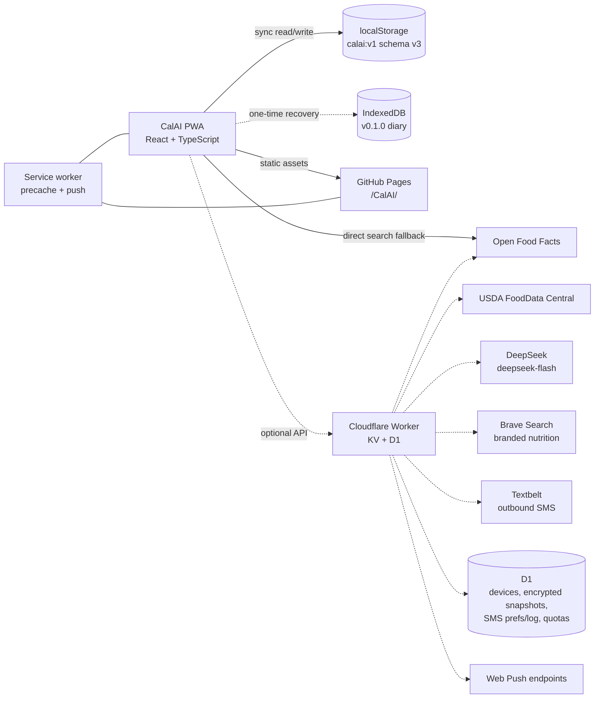

# CalAI — architecture and implementation plan

This document covers how the product plan in [../PLAN.md](../PLAN.md) gets built. It
describes the v0.3 implementation in this repository. Operational caveats and a handoff
prompt are in [../NOTES.md](../NOTES.md).

## 1. System overview



The diary lives locally by default. Online food search is a runtime read; optional encrypted
cloud backup stores a device-scoped snapshot in D1. AI, SMS, and push all require the Worker.
There are no accounts and no analytics.

## 2. Stack

Chosen and shipped through v0.2:

- **Vite** (v6 line, compatible with the installed Node 20.12) + **React 18** + **TypeScript**.
- **HashRouter** (`#/today`, `#/foods`, …) so deep links work on GitHub Pages without a
  rewrite hack, including offline.
- **Zustand** for app state, with the persist middleware backed by a synchronous
  **localStorage** adapter (`calai:v1`). **idb-keyval** is used only for a bounded one-time
  read of the v0.1.0 IndexedDB diary.
- **HashRouter** routes: `#/today`, `#/day/YYYY-MM-DD`, `#/foods`, `#/recipes`,
  `#/assistant`, `#/history`, `#/settings`.
- **Plain CSS** with design tokens; no UI kit. Avoids restyling fights and keeps the payload small.
- **vite-plugin-pwa** with `injectManifest`; a hand-written `src/sw.ts` precaches the app
  shell, serves navigation offline, and handles push/notification clicks.
- **Vitest** for nutrition, dates, backup/migration, recipes, reminders, remote parsing,
  preferences, local NL parsing, image sizing, assistant context, SMS helpers, and Worker
  normalization/AI/SMS.
- **Playwright + axe-core** for committed E2E regressions and accessibility scans.
- **Cloudflare Worker** (`worker/`) for optional search caching, USDA, AI proxying, encrypted
  D1 backup, SMS cron, rate caps, and push.
- **DeepSeek** `deepseek-flash` (DeepSeek-V4.1-Flash-1017) for vision, text parsing, chat, and
  recipes. JSON output mode; thinking disabled for latency.
- **Brave Search** for current branded/packaged nutrition and ingredient evidence. The key is
  a Worker secret; queries contain only food/brand text and results are cached for 24 hours.
- **Textbelt** for outbound-only SMS reminders.
- Inline SVG icon components; no icon library.
- System font stack; no third-party font requests (privacy, offline, speed).

Additional choices, by release:

| Need | Choice | Release |
| --- | --- | --- |
| Remote food search | OFF direct fallback; Worker + KV cache + USDA | **v0.2** |
| Barcode | `BarcodeDetector` with lazy `@zxing/browser` fallback | **v0.2** |
| Push reminders | Worker cron + `web-push` + VAPID + KV | **v0.2 code; config pending** |
| Vision / text parsing | Worker → DeepSeek vision, JSON output, user confirmation | **v0.3** |
| Chat | Worker + locally computed context; proposals confirm client-side | **v0.3** |
| Recipe book / AI recipes | Curated data + DeepSeek generation/recommendation | **v0.3** |
| Cloud backup | D1 + device auth + AES-GCM snapshots | **v0.3 code; deploy pending** |
| SMS reminders | Textbelt via Worker cron; consent + dedupe | **v0.3 code; deploy pending** |
| E2E tests | Playwright (Chromium, mobile viewport) | **v0.2/v0.3** |
| Charts | Hand-rolled SVG (no chart library) | **v0.2** |

## 3. Repository layout

Current:

```
.
├── index.html              # Vite entry; React mounts into #root
├── 404.html
├── assets/                 # built output is not committed
├── public/                 # icons, manifest inputs
├── src/
│   ├── main.tsx
│   ├── app/                # shell, routes, providers
│   ├── components/         # shared UI (Sheet, Button, Progress, …)
│   ├── features/
│   │   ├── onboarding/
│   │   ├── today/
│   │   ├── ai/                # AiLogSheet, AssistantPage
│   │   ├── foods/
│   │   ├── recipes/
│   │   ├── history/
│   │   └── settings/          # personalization, cloud, SMS, data
│   ├── lib/                   # dates, nutrition, search, backup, remote, AI, sync, SMS
│   ├── data/
│   │   ├── seedFoods.ts
│   │   └── curatedRecipes.ts
│   ├── store/
│   ├── styles/
│   └── sw.ts               # injectManifest service worker + push handlers
├── worker/                 # optional Cloudflare Worker
├── e2e/                    # committed Playwright suite
├── docs/
├── vite.config.ts
├── tsconfig.json
└── package.json
```

Worker (shipped in v0.3):

```
worker/
  src/index.ts             # router: search, barcode, push, AI, auth, sync, SMS, cron
  src/ai.ts                # DeepSeek calls, prompts, output validation, web-aware refinement
  src/web.ts               # Brave Search client, cache, quotas, source sanitization
  src/auth.ts              # device registration + bearer auth
  src/crypto.ts            # SHA-256, AES-GCM, random tokens
  src/db.ts                # D1 schema bootstrap
  src/sync.ts              # encrypted snapshot storage
  src/sms.ts               # Textbelt, consent, dedupe, cron delivery
  src/quota.ts             # KV/D1/memory quotas
  src/normalize.ts         # OFF/USDA → FoodDTO, dedupe, ranking
  src/providers/off.ts
  src/providers/usda.ts
  src/cache.ts             # KV cache + per-IP daily cap
  src/types.ts
  migrations/0001_init.sql
  wrangler.toml
```

The Worker is a separate deployable with its own secrets. The PWA remains static and fully
usable without it.

## 4. Data model

All timestamps are epoch milliseconds. Day keys are local `YYYY-MM-DD` strings, never UTC
dates.

```ts
type Meal = 'breakfast' | 'lunch' | 'dinner' | 'snack';

type Nutrients = { kcal: number; protein: number; carbs: number; fat: number };

type FoodCategory =
  | 'protein' | 'dairy' | 'grains' | 'fruit' | 'vegetables'
  | 'fats' | 'drinks' | 'meals' | 'snacks' | 'condiments';

type MuscleGroup =
  | 'chest' | 'back' | 'shoulders' | 'arms' | 'core' | 'glutes' | 'legs';

type Entry = {
  id: string;
  date: string;              // local YYYY-MM-DD
  meal: Meal;
  foodId?: string;           // absent for quick add
  name: string;
  servingLabel: string;
  quantity: number;          // multiplier of the serving
  nutrients: Nutrients;      // per-serving snapshot, frozen at log time
  createdAt: number;
};

type Targets = { kcal: number; protein: number; carbs: number; fat: number };

type Profile = {
  sex: 'female' | 'male' | 'unspecified';
  age: number;
  heightCm: number;
  weightKg: number;
  activity: 'sedentary' | 'light' | 'moderate' | 'active' | 'very_active';
  goal: 'lose' | 'maintain' | 'gain';
  rateKgPerWeek: number;
  targetWeightKg?: number;      // optional, user-set only
  muscleFocus?: Partial<Record<MuscleGroup, number>>; // 0–100 emphasis
};

type Food = {
  id: string;
  name: string;
  brand?: string;
  barcode?: string;
  servingLabel: string;
  servingGrams?: number;
  nutrients: Nutrients;
  source: 'seed' | 'custom' | 'off' | 'usda' | 'recipe';
  category?: FoodCategory;
  createdAt: number;
};

type RecipeIngredient = {
  foodId?: string;
  name: string;
  servingLabel: string;
  quantity: number;
  nutrients: Nutrients;      // per serving of the ingredient
};

type Recipe = {
  id: string;
  name: string;
  servings: number;
  ingredients: RecipeIngredient[];
  description?: string;
  instructions?: string[];
  tags?: string[];
  source?: 'user' | 'ai' | 'curated';
  createdAt: number;
  updatedAt: number;
};

type Preferences = {
  trackingStyle: 'quick' | 'detailed';
  photoLogging: boolean;
  textLogging: boolean;
  aiChat: boolean;
  recipeIdeas: boolean;
  aiConsentAt: number | null;
  diet: 'no_preference' | 'omnivore' | 'vegetarian' | 'vegan' | 'pescatarian'
    | 'halal' | 'kosher' | 'other';
  avoidIngredients: string[];
  cuisines: string[];
};

type PersistedV3 = {
  schemaVersion: 3;
  onboarded: boolean;
  profile: Profile | null;
  targets: Targets;
  customFoods: Food[];
  remoteFoods: Food[];       // capped at 100 cached OFF/USDA foods
  entries: Entry[];
  favorites: string[];
  recentFoodIds: string[];
  recipes: Recipe[];
  weights: WeightEntry[];
  water: WaterEntry[];
  reminders: ReminderSettings;
  settings: {
    theme: 'dark' | 'light' | 'system';
    units: 'metric' | 'imperial';
    waterGoalMl: number;
  };
  preferences: Preferences;
  sms: {
    enabled: boolean;
    phone: string;
    consentAt: number | null;
    lastTestAt?: number;
  };
  cloudSync: { enabled: boolean; lastSyncedAt: number | null };
  chatMessages: { id: string; role: 'user' | 'assistant'; content: string;
    createdAt: number; window?: string; error?: boolean }[];
};
```

The Worker now stores, only when the user opts in:

- device records: random device ID + SHA-256 hash of a server-issued bearer token;
- encrypted cloud snapshots (AES-GCM, device-scoped, no SMS phone);
- SMS preferences: encrypted phone, consent timestamp, timezone, quiet hours,
  enabled reminder times;
- SMS delivery log (device, reminder ID, local day, status) for deduplication;
- rate-limit counters; plus KV search cache, push subscriptions, and push sent markers;
- a public `shared_foods` table (name, brand, serving, nutrition, category, search query, hit
  count) holding AI-generated foods so a search by one device can help the next. It contains no
  device ID and no diary content.

AI prompts, photos, text, food names, and calorie values are not logged. AI-generated shared
food names and nutrition are public library content, not user diary data.

### Persistence and migration (v0.1.1 → v0.3)

v0.1.0 shipped with asynchronous IndexedDB hydration. When IndexedDB was blocked (privacy
settings, private windows, in-app browsers) or an open request never settled, the app stayed
on its opening screen forever. v0.1.1 removes that failure mode:

- The diary is a synchronous localStorage document at `calai:v1`, written by Zustand persist.
  There is no storage-driven splash and no async gate before onboarding.
- `calai-theme` mirrors the theme setting for the pre-hydration inline script.
- `calai:legacy-checked` records that the one-time IndexedDB migration was attempted.
- On first run, a **bounded background read** (1.2 s timeout) of the old `calai:v1` IndexedDB
  key via `idb-keyval` imports a v0.1.0 diary only if the current state is empty. The UI is
  already interactive while this happens; a toast confirms a restore. A missing, blocked, or
  corrupt legacy store is ignored and marked checked.
- localStorage writes are wrapped in try/catch. If storage is blocked entirely, the app runs
  in memory and shows a persistent warning; nothing silently hangs.
- Corrupt persisted JSON is discarded so the app falls back to onboarding instead of crashing.
- Storage is requested persistent on first log (`navigator.storage.persist()`) where supported.
- Payload size is small (entries, custom foods, saved online foods, recipes, weights, water,
  settings, preferences, chat; seed foods are static). The remote-food cache is capped at 100
  items. v0.3 keeps localStorage; granular IndexedDB is deferred until measured payload/write
  growth justifies it.
- v0.3 uses `schemaVersion: 3`. `validatePersistedData` accepts v1, v2, or v3; v1/v2
  documents and backups are normalised in memory with default preferences, SMS/cloud state,
  and an empty chat transcript, then written back as v3. Unknown future versions are
  rejected. The Zustand storage adapter always returns version 3 after validation, so no
  async migration gate is introduced.
- Export envelope: `{ app: "calai", schemaVersion: 3, exportedAt, data }`. Import validates
  the envelope and every nutrient number; importing a v1/v2 backup migrates it first. SMS
  phone numbers are stripped from exports, and imports preserve the device's existing SMS
  settings and disable cloud auto-sync until the user re-enables it.

### Nutrition and target math

- Stored food nutrients are per serving. Entries keep a per-serving snapshot and a quantity
  multiplier; totals multiply on read, so editing a food never rewrites old days.
- Totals are pure functions over entries for a date, rounded for display only.
- Targets: Mifflin–St Jeor BMR × activity factor, adjusted by goal and rate
  (≈ 7700 kcal per kg). Protein default 1.6 g/kg, fat 25% of kcal, carbs fill the rest.
- A 1200 kcal floor is enforced with a non-judgemental note; manual targets may still be
  lower only with a warning. This is a safety guardrail, not medical advice.
- Units: metric internally (kg, cm, ml); imperial is presentation-only for body stats,
  weight, water, and portions. Defaults are dark theme, imperial body units (lb/ft), and the
  `en-CA` presentation locale; users can switch to metric or system theme.
- Onboarding persists the chosen units into Settings on completion. `DEFAULT_SETTINGS` is the
  single source for theme, units, and the water goal.

## 5. Food data

v0.3 ships ≈220 curated common foods in the bundle, each with a category used for browsing
and filtering. Seed foods are not editable; users create custom foods. Values are rounded
public nutrition references. Search covers seed + custom + remote + recipes and is
case-insensitive over name/brand. Recents are derived from `recentFoodIds` updated on log.
The AI logging sheet can match recognised names to seed/custom foods and use a library value
when a gram serving is available.

v0.2 remote search:

- **Open Food Facts** — product search and barcode lookup, ODbL, attribution required. The
  client can query it directly (CORS) when `VITE_API_BASE` is unset.
- **USDA FoodData Central** — public domain, API key required; US-centric but higher quality.
  Only available through the Worker; the key never reaches the client.
- The Worker normalises both providers to a 100 g `Food` shape, dedupes by barcode/name,
  filters out products whose name/brand does not contain every query token, ranks exact and
  prefix matches first, and caches successful responses in KV for 7 days.
- The client applies the same relevance filter to direct OFF results. Results always show the
  source; community data is labelled as an estimate.
- Seed foods remain available offline. Remote results require network and fail gracefully;
  a food is written to the local `remoteFoods` cache when selected/logged, so it can be
  searched and logged offline afterwards.
- A Worker request is capped per IP per UTC day (default 300) when KV is bound. Search and
  barcode responses include `sources` and `cached` metadata.

## 6. AI architecture (v0.3.1)

### Provider and credentials

- Model: `deepseek-flash`, served by DeepSeek-V4.1-Flash-1017. The API is OpenAI-compatible
  at `https://api.deepseek.com`. The key is a Worker secret (`DEEPSEEK_API_KEY`).
- Brave Search (`BRAVE_SEARCH_API_KEY`, `https://api.search.brave.com/res/v1/web/search`) is
  used only for branded/packaged/restaurant items and food discovery. Results are sanitized,
  capped, KV-cached for 24 hours, and never trusted as instructions.
- JSON output mode (`response_format: { type: 'json_object' }`), thinking disabled, bounded
  `max_tokens`, explicit timeouts (25–60 s), and no automatic retries.
- The verified provider docs confirm vision, JSON output, system messages, and image limits.
  Live smoke tests against the Worker's handler code succeeded for text parsing, a banana
  photo, recipe generation, and Brave search.

### Endpoints

| Endpoint | Purpose | Default cap |
| --- | --- | --- |
| `POST /v1/auth/register` | Issue a random device token; store only its SHA-256 hash | 10/day per IP |
| `PUT/GET/DELETE /v1/sync` | Encrypted cloud snapshot, device-scoped | 1 MB payload |
| `POST /v1/ai/recognize` | Image → structured food candidates | 10/day per device+IP |
| `POST /v1/ai/parse` | Text → structured items | 40/day per device+IP |
| `POST /v1/ai/chat` | Grounded Q&A + optional proposal | 60/day per device+IP |
| `POST /v1/ai/recipes` | Generate or rank recipes | 20/day per device+IP |
| `GET /v1/foods/library` | Search the shared AI-generated food library | 300/day per IP |
| `POST /v1/foods/discover` | Brave + DeepSeek generate 4–6 foods, store in D1 | 20/day per device+IP |
| `POST /v1/sms/prefs` | Save consent, phone, reminders | authenticated device |
| `POST /v1/sms/test` | One test text | 1/day per device |
| `DELETE /v1/sms/prefs` | Delete SMS preferences | authenticated device |
| `GET /v1/foods/search` | OFF/USDA proxy | 300/day per IP (KV) |

Quotas prefer D1 when bound because its increment is atomic, then KV, then isolate memory for
local dev. A monthly global request cap (`AI_MONTHLY_REQUEST_CAP`, default 5,000)
short-circuits AI calls. Brave has separate per-device/day (`WEB_DAILY_SEARCHES`, default 30)
and global/month (`WEB_MONTHLY_SEARCHES`, default 1,000) caps plus a 24-hour KV cache. No API
keys reach the client.

### Vision flow

1. Client validates the file, downscales to ≤ 1024 px JPEG on canvas (strips EXIF), and shows
   consent if needed.
2. `POST /v1/ai/recognize` sends a base64 data URL; the Worker checks the declared MIME,
   decoded size (≤ 5 MB), and magic bytes.
3. DeepSeek is called with a system prompt and an image content block. It returns
   `{ items: [{ name, quantityLabel, grams, kcal, protein, carbs, fat, confidence, notes,
   webQuery }], note }`. `webQuery` is optional and only set for a branded/packaged/restaurant
   item where current nutrition may differ from a generic estimate.
4. The Worker clamps every number, caps items, and returns confidence; it does not store the
   image.
5. If any item has a `webQuery`, the Worker runs up to two Brave searches, then one refinement
   pass over only those items. The refinement must cite a clearly matching product/serving;
   otherwise the original estimate is kept. Responses include sanitized `webSources` for the
   UI's “Web-checked” links.
6. The client matches each name to the local library, can apply a library value when a gram
   serving exists, and lets the user edit name, grams/servings, and macros.
7. Nothing is logged until the user presses the final log button. Items can be saved to the
   custom-food library.
8. Failure/offline/over-quota → a clear message, retry, or manual search with the meal context
   preserved.

### Text, chat, and recipes

- Text parsing reuses the item schema minus the image. An offline matcher covers simple
  phrases against local foods; it never invents nutrition and reports unmatched text. AI text
  parsing uses the same `webQuery` refinement as vision.
- Food discovery runs when a search has at least two characters and AI consent is present. The
  client first queries `/v1/foods/library`, then `/v1/foods/discover`; the Worker returns stored
  matches immediately when it already has four or more and otherwise searches Brave, asks
  DeepSeek for 4–6 foods grounded in those snippets, clamps them, stores them in
  `shared_foods`, and returns them. Web-grounded rows keep `source: "ai"` for backward
  compatibility and add `web: true`; the client shows “Web + AI”. The client appends each
  response as it arrives and shows a live “finding items” indicator.
- Chat context is assembled on the client: goal, target weight, training focus, preferences,
  7/14/30-day totals and averages, logged days, recent food names, weight, water, and active
  reminder meals. No email, account ID, or raw entries are sent.
- The response contract is `{ reply, window, suggestions, proposal? }`. Numeric claims must
  come from the supplied context, missing data is stated, and the UI renders `window` as a
  chip. A proposal is shown as a review card and is only written after confirmation.
- Recipes use `POST /v1/ai/recipes` in `generate` mode (prompt, meal, servings, time,
  preferences, training focus) or `suggest` mode (curated candidate IDs + preferences).
  Generated recipes are   previewed and saved only on approval; the user can edit ingredients
  and method afterwards.
- Food search discovery uses the shared D1 library plus DeepSeek generation. The client shows
  stored and generated matches as they arrive with a live finding indicator. AI foods carry an
  “AI estimate” label and are cached locally only when selected. A search sends only the typed
  words, never diary values.
- Transcripts live locally under `chatMessages` (cap 60) with a clear-chat action.

### Safety and privacy

- AI is opt-in. Photo and text shortcuts are visible by default in v0.3.1, but no AI request
  is sent until explicit consent; coach and recipe toggles default off. Offline text matching
  always works without consent or a network.
- System prompts forbid medical diagnosis, extreme dieting, and shaming; they also tell the
  model to treat images and context as data, not instructions.
- The Worker never logs prompts, photos, text, food names, or calorie values. It logs status
  codes only.
- AI output is labelled as an estimate and is never treated as verified nutrition.
- Before public scale, add a formal eval set, provider budget alerts, and abuse protection
  (Turnstile or accounts). Current protection is quotas plus a server-side key.

## 7. Reminders (SMS only)

The in-app banner, `.ics` export, and client push subscription were removed in v0.3. All
reminder behavior is managed in Settings → SMS reminders.

- Four meal times, off by default, plus quiet hours. Turning on at least one meal updates the
  persisted schedule; the same schedule is sent with SMS preferences.
- The section is split into padded blocks (intro, send toggle, schedule, number/consent,
  preview, actions) rather than one dense card.
- The client requires a country-code phone number, explicit consent, at least one meal time,
  and a timezone. The Worker encrypts the phone with `DATA_ENC_KEY` and stores it separately
  from diary data.
- The cron runs every five minutes, resolves local time with `Intl.DateTimeFormat`, honors
  quiet hours, caps delivery at four texts per device per local day, and dedupes with a unique
  `(device_id, reminder_id, day)` row in `sms_log`.
- Messages are outbound only, contain no food/calorie data, and say replies are not monitored.
  Turning SMS off deletes the server row. If that request fails, the UI keeps the controls
  visible and warns that delivery may continue.

Dormant push tier:

- Worker `/v1/push/*` endpoints, KV subscription storage, VAPID secrets, cron delivery, and
  service-worker push handlers remain in the codebase, but no client UI subscribes. They can be
  removed or re-enabled in a later release.

SMS tier (implemented in v0.3):

- Outbound only. The client collects a phone number, an explicit consent checkbox, and the
  same enabled reminder times/quiet hours; the Worker requires authenticated device ownership
  and stores the phone with AES-GCM (`DATA_ENC_KEY`).
- A daily test limit and a four-text/day cap per device, plus a unique
  `(device, reminder, local day)` log row, prevent duplicate or runaway messages.
- The cron resolves local time per stored timezone, applies quiet hours, sends a generic
  message (`CalAI: time to log lunch. Replies are not monitored.`), and records sent/failed
  status. Phone numbers and API keys never appear in payloads or logs.
- Turning SMS off deletes the server-side row; if that request fails, the UI keeps the
  preference visible and tells the user so delivery may continue.
- SMS preferences are excluded from JSON exports and cloud snapshots.

## 8. PWA and offline

- `vite-plugin-pwa` runs in `injectManifest` mode; `src/sw.ts` calls `precacheAndRoute` for
  the app shell, hashed assets, icons, and the lazy ZXing chunk, with a NavigationRoute
  fallback to `/CalAI/index.html`.
- Navigation uses hash routes, so no server-side rewrite is needed. Remote search is
  network-only and is never precached; selected remote foods are persisted in localStorage.
- Update flow: `autoUpdate` with `skipWaiting` in alpha. There is still no non-blocking "new
  version" prompt before an entry sheet; this remains a v0.2.x improvement.
- The service worker handles `push` and `notificationclick`: generic payload, icon, meal tag,
  and focus/open the Today route. Camera frames and barcode values never enter the cache.
- Manifest: `start_url` and `scope` under `/CalAI/`, standalone display, dark theme,
  192/512 PNG + maskable, Apple touch icon, safe-area CSS.
- Storage: ask for persistence after the first log; surface export as the reliable backup.

## 9. Deployment

v0.3 PWA:

- GitHub Actions workflow builds with Node 20 and publishes `dist` via
  `actions/configure-pages`, `actions/upload-pages-artifact`, `actions/deploy-pages`.
- Pages source is **GitHub Actions** (`build_type: workflow`); `.github/workflows/deploy.yml`
  runs unit tests, typecheck, the local-first build, and the default E2E suite, then rebuilds
  with `VITE_API_BASE` and `VITE_VAPID_PUBLIC_KEY`, runs the configured-AI suite, and deploys
  `dist/` on every push to `main`.
- `vite.config.ts` sets `base: '/CalAI/'`; the manifest mirrors it.
- No secrets are needed for the static app. API/push env values are build-time `VITE_*`
  variables. Production sets `VITE_API_BASE=https://calai-api.braille.workers.dev` and the
  public VAPID key, so AI/cloud/SMS/push are enabled.

Worker (v0.3):

- Deployed as `calai-api` at <https://calai-api.braille.workers.dev> with KV `CALAI_CACHE`
  (`4720c88208744717a583112e89def60f`) and D1 `calai`
  (`8d689615-14b6-4951-84d4-651d92eb0970`); the ids live in `worker/wrangler.toml`.
- Secrets via `wrangler secret put`: `DEEPSEEK_API_KEY`, `TEXTBELT_API_KEY`,
  `BRAVE_SEARCH_API_KEY`, `DATA_ENC_KEY` (32 random bytes, base64), optional `USDA_API_KEY`, and
  `VAPID_PUBLIC_KEY` / `VAPID_PRIVATE_KEY` / `VAPID_SUBJECT` for push. The VAPID public key is
  also passed to the client as `VITE_VAPID_PUBLIC_KEY` at build time.
- Run `npx wrangler d1 migrations apply calai --remote` (optional; `ensureSchema` also
  creates tables on first use). The initial migration is applied in production.
- `compatibility_flags = ["nodejs_compat"]` for `web-push`; `compatibility_date = 2025-09-01`.
- CORS allowlist defaults to `https://braillegov.github.io`, localhost dev ports, and
  `127.0.0.1`; override with `ALLOWED_ORIGINS`.
- Cron every 5 minutes: push delivery (if VAPID is configured) and SMS delivery (if Textbelt
  and D1 are configured). KV stores search/barcode caches, quotas, push subscriptions, and
  sent markers; D1 stores devices, encrypted snapshots, SMS preferences/log, and quotas.
- Local dev: `wrangler dev` with a gitignored `worker/.dev.vars`, then build the client with
  `VITE_API_BASE=http://localhost:8787`. On this Windows/Node 20 machine workerd still fails to
  start, so production HTTP behavior is verified with live smoke tests instead. See
  `worker/README.md`.
- Router handlers are awaited inside the top-level `try` so `AiError`, `SyncError`, and
  `SmsServiceError` map to their HTTP statuses instead of becoming Cloudflare 1101 exceptions.

Headers: GitHub Pages cannot set response headers. A `<meta http-equiv="Content-Security-Policy">`
is added at v1.0 after auditing inline styles; `frame-ancestors` is not enforceable that way.
The Worker sets its own CSP/CORS headers.

## 10. Security, privacy, legal

- Health data is sensitive. Local-first by default; no analytics on food names or values.
- No third-party scripts. If analytics are added, they are cookieless, consent-gated, and
  limited to interaction events.
- AI requests carry a random device token, not identity. Quotas are per device+IP; there is a
  global monthly request cap. AI is opt-in and revocable.
- Device auth: the Worker issues a 256-bit random token and stores only its SHA-256 hash;
  sync/SMS requests use `Authorization: Bearer` plus the device ID. AI endpoints rely on
  device/IP quotas; add Turnstile or accounts before public scale.
- Cloud snapshots and SMS phone numbers use AES-GCM with `DATA_ENC_KEY`. Snapshots exclude the
  phone; exports exclude it too. A lost device token means a new device identity; there are no
  accounts to recover. The phone is also present in this device's local app storage while SMS
  is configured, the same trust boundary as the diary.
- SMS is outbound only, consent-gated, quiet-hour aware, capped at four per day per device,
  deduped per reminder/day, and includes “replies are not monitored”. Turning it off deletes
  the server row; failure keeps the UI in a state where the user can retry.
- Worker: payload size caps, image magic-byte checks, rate limits, output schema validation,
  no content logging, explicit timeouts, and provider fallbacks. Provider keys never leave the
  Worker.
- Export/delete-all must always be available. Reset attempts to stop SMS delivery before
  clearing local data.
- Before public launch: privacy policy, terms, AI disclaimer, data-source attributions
  (Open Food Facts ODbL, USDA), a contact address, and a formal AI eval.
- Accessibility target: WCAG 2.2 AA — labels, focus traps in dialogs, 44 px targets, no
  colour-only status, reduced motion.

## 11. Testing and QA

- **Unit (Vitest):** target math, macro rounding, date keys across DST, search ranking,
  import validation and v1/v2→v3 migration, nutrient scaling, recipe totals and curated
  integrity, OFF parsing, preferences, local NL parsing, image sizing, assistant context, SMS
  helpers, shared AI food normalization, and Worker normalization/AI/SMS.
- **E2E (Playwright, committed and in CI):** onboarding with personalization → log → reload
  persistence → edit → delete → export/import at 390 × 844; blocked localStorage, blocked
  IndexedDB, corrupt state, legacy IDB recovery; offline reload; online search success/failure;
  AI shared food discovery in the configured build; manual barcode lookup; recipe
  creation/logging; curated recipe detail/save; offline text logging; water and weight
  persistence; SMS-only settings with no in-app controls; assistant and cloud/SMS setup states;
  horizontal overflow at 360/390 px; axe scans in both themes.
- **Accessibility:** axe-core with WCAG 2.0/2.1/2.2 A/AA tags, animations finished before
  scanning, 0 violations on all main screens and open sheets.
- **Device pass:** iPhone Safari (installed), Android Chrome, desktop Chromium.
- **Performance:** Lighthouse budgets; initial JS < 200 KB gzip.
- **AI evals:** live provider smoke tests exist for text, vision, and recipe generation. A
  formal 50-photo/30-question eval set, unsafe-output review, and cost-per-accepted-log
  measurement are still required before public launch.

## 12. Observability and cost

- v0.1: none beyond build/deploy status and local error surfaces.
- v0.2+: Cloudflare Worker logs for status/latency only; error reporting (e.g. Sentry) is
  opt-in and scrubbed of health content.
- Recurring cost target: $0 for Pages at alpha scale; KV/D1 within free tiers at small scale.
  AI is capped by per-device daily quotas and a global monthly request cap; a dollar budget
  alert is still required before public scale.

## 13. Versioning and migration

- Persisted state includes `schemaVersion`. v0.1 writes version 1; v0.2 writes version 2;
  v0.3 writes version 3.
- `validatePersistedData` migrates v1/v2 to v3 in memory and rejects unknown future versions.
  The storage adapter always returns version 3 after validation, so no async migration gate
  is introduced.
- Migrations are pure functions tested against fixtures, including a legacy IndexedDB v0.1
  diary and v1/v2 JSON backups.
- Export is versioned and later versions can still import it; import validates ranges
  (non-negative nutrients, sane quantities, ISO dates, reminder times, barcode limits). Phone
  numbers are stripped from exports; imports preserve local SMS settings and disable cloud
  auto-sync.
- Granular IndexedDB stores remain deferred; localStorage is synchronous in v0.3. The optional
  cloud snapshot is the cross-device copy, encrypted and device-scoped.

## 14. Build order

1. Scaffold Vite/React/TS, tokens, shell, routing, PWA manifest.
2. Store + synchronous persistence + seed foods + target math (unit tests).
3. Onboarding and target review.
4. Diary: day navigation, meals, entries, quick add, portion sheet.
5. Food library: search, custom foods, recents, favorites.
6. History and settings (export/import/reset).
7. QA: 360/390 px, keyboard, offline, reload persistence, auth-free install.
8. Actions workflow, switch Pages source, verify live URL and custom 404.
9. v0.2: committed Playwright/axe suite, schema v2 migration, online search, barcode,
   recipes, weight, water, reminders.
10. v0.3: schema v3 migration, personalization onboarding, expanded food library, AI photo/
    text logging, coach, recipe book, encrypted D1 backup, SMS.
11. v0.3.x: Worker deployed to <https://calai-api.braille.workers.dev> with KV, D1,
    migrations, DeepSeek/Textbelt/encryption/VAPID secrets, and production `VITE_API_BASE`;
    live HTTP sync/AI checks pass. Remaining: SMS delivery and physical-device pass.

v0.1.0 shipped on 2026-10-24; v0.1.1 hardened storage; v0.2.0 shipped on 2026-10-24; v0.3.0
is deployed with the Worker, AI, SMS, cloud, and push tiers enabled.

## 15. v0.1 verification record

- Unit tests: 27 passing across nutrition/target math, date keys, food search, backup
  validation, and legacy IndexedDB state parsing.
- Browser smoke (Edge, 390 × 844, mobile emulation): onboarding in metric and imperial,
  logging from search, quick add, custom foods, entry edit/delete, export/import, reset,
  validation errors, theme persistence across reloads, scroll reset on navigation, Escape
  closing sheets, and a full offline reload served by the service worker.
- Layout: no horizontal overflow at 360 px or 390 px; frame caps at 560 px on desktop.
- Storage recovery: blocked IndexedDB no longer blocks onboarding; a seeded v0.1.0
  IndexedDB diary migrates to localStorage; blocked localStorage shows a warning and the app
  remains usable in memory; corrupt persisted JSON recovers to onboarding.
- PWA: manifest resolves at `/CalAI/manifest.webmanifest` with `/CalAI/` scope and three
  icons; service worker registers and controls the page on the live HTTPS origin.
- axe-core: 0 WCAG 2.1 A/AA violations across onboarding, diary, add/edit sheets, foods,
  history, and settings in dark and light themes.
- Lighthouse mobile (live deployment): Performance 100, Accessibility 100, Best Practices
  100, SEO 60 (intentional `noindex` during alpha).
- Bundle: initial JS 73.3 KB gzip, CSS 5.8 KB gzip.
- Live: <https://braillegov.github.io/CalAI/>, custom 404 served, HTTP redirects to HTTPS.
- Version: v0.1.1.

## 16. v0.2 verification record

- Unit tests: 46 passing (nutrition/target math, dates, search, backup validation and v1→v2
  migration, legacy IndexedDB recovery, recipes, reminders incl. `.ics`, remote OFF parsing,
  Worker normalization).
- Playwright: 30 tests passing on Chromium at 390 × 844 (Pixel 7 descriptor), including
  onboarding, logging, edit/delete, quick add, custom foods, favorites, export/import,
  malformed imports, blocked localStorage, blocked IndexedDB, corrupt state, legacy IDB
  recovery, offline reload, online search success/failure, manual barcode lookup, recipes,
  water, weight, reminders/.ics, layout, and axe scans. The suite is committed under `e2e/`
  and runs in the deploy workflow before upload.
- axe-core: 0 WCAG 2.0/2.1/2.2 A/AA violations across onboarding, Today (with water), add/edit
  sheets, foods, recipes, recipe form, history, settings, expanded reminders, and barcode in
  dark and light themes. Animations are finished before scanning.
- Layout: no horizontal overflow at 360 px or 390 px on Today, Foods, Recipes, History, and
  Settings; five-item bottom navigation fits.
- Online search: mocked OFF responses in E2E; live smoke tests returned category results for
  “banana” and brand results for “nutella”/“oatly” when OFF was not rate-limiting. Direct OFF
  calls can return 503 under bursty use; the app falls back to local foods with a clear note,
  and the Worker cache is the mitigation.
  Failure/offline paths fall back to local foods with a clear note.
- Barcode: manual lookup path tested with a mocked OFF product; `BarcodeDetector` and ZXing
  paths are code-complete but not exercised on a physical camera in this session.
- PWA: injectManifest service worker precaches 17 entries (751.8 KiB), serves an offline
  reload, and includes push/notificationclick handlers. Manifest scope remains `/CalAI/`.
- Bundle: initial JS 87.2 KB gzip + 2.4 KB workbox window; CSS 6.9 KB gzip; lazy ZXing chunk
  108.7 KB gzip loaded only when `BarcodeDetector` is missing. Under the 200 KB initial-JS
  budget.
- Storage: v1 documents/backups and v0.1.0 IndexedDB diaries migrate to v2; blocked storage
  and IndexedDB remain non-blocking. Remote cache capped at 100 foods.
- Not run in this session: live Lighthouse after the bundle change, physical iOS/Android
  devices, installed-PWA push, USDA live calls, Worker deployment.
- Version: v0.2.0.

## 17. v0.3 verification record

- Unit tests: 86 passing across the v0.2 areas plus preferences normalization, local text
  parsing, image sizing, assistant context, curated recipe integrity, SMS helpers, AI response
  sanitization, shared AI food normalization, and Worker AI/SMS handling.
- Playwright: 35 tests on Chromium at 390 × 844. The local-first build runs 34 (the
  configured-AI test is skipped); the Worker-enabled build runs
  `e2e/ai-configured.spec.ts` against a mocked Worker. Coverage includes the new onboarding
  steps, target-weight/muscle controls, settings personalization editing, offline text logging,
  curated recipe detail/save, assistant setup and configured states, cloud/SMS setup states,
  photo → review → log, coach proposal → confirm, AI recipe picks, and new-screen overflow
  checks. axe-core reports 0 WCAG 2.0/2.1/2.2 A/AA violations on the new screens.
- Layout: no horizontal overflow at 360/390 px on Today, Foods, Recipes, Discover, History,
  Settings, and Assistant.
- Bundle: initial JS 117.1 KB gzip + 2.4 KB workbox window; CSS 8.9 KB gzip; lazy ZXing chunk
  108.7 KB gzip. PWA precache 17 entries (867.4 KiB).
- D1 schema: `worker/migrations/0001_init.sql` validated with SQLite; tables for devices,
  encrypted snapshots, SMS preferences/log, and rate limits.
- Live deployment smoke tests (through `https://calai-api.braille.workers.dev`): `/health`
  reported search/AI/sync/SMS/push true; CORS returned the Pages origin; KV-cached Open Food
  Facts search returned results; device registration, encrypted snapshot PUT/GET/DELETE
  round-tripped with 404 after delete; DeepSeek text parse, coach with a 7-day window, recipe
  generation, and vision on a real banana photo returned valid output. A browser run against the
  production bundle logged AI-parsed items, enabled and deleted cloud backup, and received a
  grounded coach reply.
- Fixed during deployment: route handlers were returned without `await`, so typed errors escaped
  the router catch and surfaced as Cloudflare 1101. Handlers now await and map statuses (422
  verified for a non-food image).
- Playwright: 35 tests total. The local-first build runs 34 (configured-AI test skipped); the
  Worker-enabled build runs the configured-AI test with a mocked Worker. axe-core remains at 0
  WCAG A/AA violations.
- Textbelt quota remains 192 from the earlier consented test; no new SMS was sent during the
  deployment session. SMS cron, quiet hours, cap handling, and opt-out remain unverified.
- Not run: local Worker HTTP routing (workerd still fails on this Windows/Node 20 machine),
  installed-PWA push, USDA live calls, physical camera, iOS/Android device pass, Lighthouse on
  the v0.3 bundle.
- Version: v0.3.0 (deployed 2026-10-25).

## 18. v0.3.1 web grounding, hardening, and UI update (2026-10-25)

- Camera-first logging: meal `+` opens AI photo logging with a persistent manual
  search/barcode link; the quick-log row leads with Camera. Photo logging is on by default,
  with the onboarding consent gate unchanged.
- Today spacing: the quick-log panel clears the day title and meals sit 28 px below the water
  card. Settings SMS and cloud cards use padded, separated blocks instead of one dense card.
- Reminders are SMS only. The in-app banner, `.ics` export, push subscription UI, and their
  reminder helpers were removed; SMS settings owns the schedule and quiet hours.
- Shared AI food library: `shared_foods` in D1 plus `GET /v1/foods/library` and
  `POST /v1/foods/discover`. DeepSeek returns 4–6 foods with clamped per-serving nutrition;
  repeated queries use stored rows without another model call. The client shows a live finding
  indicator and appends results as each request resolves.
- AI assist: new custom foods and quick adds can be filled from a photo or a short description;
  the user reviews and edits before saving.
- Verification: 86 unit tests; 34 local-first Playwright tests plus the configured-AI test
  against a mocked Worker (35 total); axe 0 A/AA violations; no horizontal overflow at 360/390
  px. Bundle: initial JS 117.5 KB gzip, CSS 9.4 KB gzip, precache 874.3 KiB.
- Live Worker smoke test: `POST /v1/foods/discover` for “paneer” returned six foods, stored
  them, and `GET /v1/foods/library?q=paneer` returned the same six; a second discover call
  returned `cached: true` without a model call. `/health` reports `sharedFoods: true`.
- Brave Search grounding (v0.3.1): branded/packaged/restaurant items can carry a model-chosen
  `webQuery`. The Worker searches Brave, runs one refinement pass over up to two items, returns
  sanitized `webSources`, and falls back to the original estimate on any failure. Food
  discovery also uses Brave snippets and marks rows `web: true` while keeping `source: "ai"`
  for older clients.
- Hardening (v0.3.1): cloud-backup removal no longer clears the shared device token while SMS
  is enabled; reset deletes the cloud snapshot before local state; invalid persisted state is
  quarantined instead of silently lost; quota counters prefer atomic D1 updates; dormant push
  endpoints require device auth and ownership; CI now typechecks the Worker.
- Verification (v0.3.1): 97 unit tests; 34 local-first Playwright tests plus the configured-AI
  test against a mocked Worker (35 total); bundle initial JS 125.6 KB gzip, CSS 9.6 KB gzip,
  precache 898.2 KiB. The Worker deployed with `webSearch: true`; live branded parse and
  discovery returned `webSources`, and discovery rows returned `web: true`.
- Version: v0.3.1 (Worker and Pages deployed 2026-10-25).
